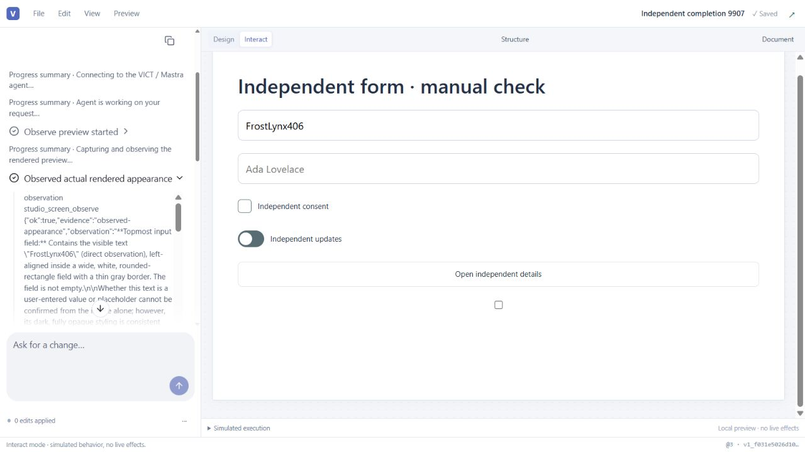

# Cycle 1.3 completion — independent verification

2026-10-24. **PASS — independently verified readiness for owner review**, for product **be893f29d44f595a8d9982575c2199636df69597**, with evidence delivery **040de336344f1b370bde202d62a5b674d0cf859a**. The completion branch is `codex/studio-cycle-1-3-completion`; origin/main remains `d7401bef6e48330796c74ec00c86db9622d48cdf`. This verifier implemented no product repairs. Owner acceptance remains pending; Stage 9 remains REOPENED / IN PROGRESS. The next allowed action is the owner's integrated review. This verdict authorizes no merge, publication, deployment or next cycle.

## Final identity, execution and evidence

The evidence delivery is a descendant of the product with no production-source delta. Independent rehash of the final served build matches all **934 declared source inputs and 289 outputs**, with zero mismatches (`completion-independent/seal-audit-be893.json`). This is the declared build seal, not a claim of a hermetic build. The final independently installed public consumer matches **173 package source files** and both tarballs: AI `5a79a2d1c1b84c66a044c39380f56a85a75e0580026133ad28c80dd3a0280896` and Flow `feacec984e5cdcf809e58d68c3b5df3121604b5fb7df52249fab44ce0501be7f` (`consumer-audit-be893.json`). No workspace aliases substitute for installation.

The independent full Studio run at 3794 passed **260 tests / 1 live test skipped**, including ten verifier regressions. Subsequent changes were rechecked by affected scope: 9907 visual/HTTP 21 PASS, 115f orientation/Structure/source 7 PASS, final be893 capture 21 PASS across five files. Public Flow and final public AI static checks have zero errors/warnings; final Studio TypeScript passes. The exact commands and candidate-specific logs are retained below and in `completion-independent/`. This is explicit carry-forward plus affected regression verification, not a fictional full-suite rerun on be893. The final public AI CSS build also passes; an initial attempt to invoke its nonexistent npm check script is retained as a command-oracle mistake before the direct svelte-check passes. Serial final Studio production build passes after a retained host allocation failure during concurrent work. No product defect is inferred from that allocation failure.

The last product delta is nine lines in public `capture.ts`: html-to-image excludes HTML images whose own or ancestor computed display is none. A hidden empty-src Avatar fallback image had caused the actual 151-node gallery capture to fail before SVG creation. The original two safe failures and resource diagnosis remain retained. Own pre-repair filter probe fails; final probe passes while retaining visible broken, zero-size, opacity-zero, visibility-hidden and SVG images/defs. Final actual production gallery capture now reaches the configured **zai/glm-5.3-flash** model. Its 909×585 crop of the 909×4928 render has first and confirmed SHA-256 `0ba4e6674ab0699403510cf4382e723b78fe266fb87f464c6d02e0ef4d8dfd6c`, revision r1.r1#0, current preview/viewport provenance, engine completed and zero edits. The model explicitly limits its observations to the visible hero/navigation crop. The final source matches the prior saved 151-node source exactly after parsing (the prior record stores an object and the final record pretty JSON text; the raw representation mismatch is retained). This is an independent audit of the builder's genuine CUA execution record, not a second verifier execution (`final-gallery-showcase-audit-be893.json`).

The verifier separately performed a final be893 actual browser/model proof on its own saved fixture. The undisclosed runtime-only input marker **FrostLynx406** is absent from source and the first prompt; the selected model reads it correctly. First/confirmed image hash is `70df6f4f78932b06ca5aeaeadd252a7ec30885f12f7782deb7dec70929d1961e`, with post-inference source/preview/viewport/image equality, no edits and `interactionVerified:false` (`final-marker-proof-be893.json/jpg`). Actual portal refusal, closing/fresh retry, Stop, stale proposal, draft/manual/history/save/reopen and Structure journeys at 115f carry forward because be893 changes only the hidden-image filter. No earlier failed observation has been relabeled a success.

## Final closing matrix

| Requirement group | Independent final disposition and practical scope |
| --- | --- |
| Bounded source, palette and state reads; UTF-8 transport | PASS: 500-node / 200000-character boundary checks, bounded pages and lossless long state; actual HTTP exact 1200000 bytes reaches field validation and next byte returns structured 413. Framework snapshot limits remain unchanged. Direct-Request probes are separately labeled. |
| Precise schemas and recoverable diagnostics | PASS: own JSON Schema versus authoritative Zod negatives and expected shape/operation/path probes; genuine provider invalid-operation refusal followed by corrected browser-acknowledged edits. Presentation parity does not bypass canonical validation. |
| Native types, independent fields, same-batch operations and manual parity | PASS: typed number/checkbox same-batch probes; actual two native text fields independent, catalog boolean controls independent, manual canonical native checkbox independent. Provider chose a catalog checkbox despite native wording; native-checkbox browser evidence is manual, not falsely attributed to provider. Shared transactions/history and no-coercion checks pass. |
| Placeholder cleanup, intentional headings and interactive trigger compatibility | PASS: genuine provider replaces seeded popover text; nested wrapper proposal refuses and corrected trigger has actual keyboard/focus behavior with no nested interactive DOM. Existing saved-document compatibility is preserved by guarded new-authoring checks and regression coverage. |
| Equivalent large mixed request and bounded continuation | PASS at explicit equivalent-fixture scope: source audit 83/83 requested recipes, 78/78 definitions, 151 final nodes, intentional headings and no retained filler; genuine continuation/timeout/partial outcomes retained. Root's actual representative native fields, checkbox/switch, slider, accordion, pagination and overlay interactions, exact source preservation and Save/reopen are independently audited. Final actual image/model proof closes the capture failure. Presence does not imply every component state was exercised. |
| Chronological attempts, recovery, partial outcomes and compaction | PASS: own genuine five-batch UI failures/corrections/receipts; real long-provider records; controlled mounted Conversation 240-event compaction DOM test. No claim that a genuine provider turn triggered browser compaction. Engine termination and unresolved tool outcomes remain separate. |
| Stop, late results, stale/draft races, duplicate prevention, shared history and persistence | PASS: deterministic never-settling capture Stop and late-upload fence; own actual Working→Stop returns with no later sentinel; newer manual source rejects old actual proposal with UI_DOC_STALE_REVISION; pending draft refuses; exact Undo/Redo, Save/reopen and preserved source. Actual source observation after Stop is identified by its retained snapshot time rather than falsely described as a later fresh reread. |
| Actual pixels, exact model, stale detection and recovery | PASS: own undisclosed final marker and root final 151-node gallery to selected model with equal post-inference image hashes, current cursor/preview/viewport and explicit crop scope. Changed-JPEG negative fails on 3794 and passes after 9907. Visible preview-owned external portals explicitly refuse; closing and fresh retry succeeds. Screenshots do not establish bindings or interaction outcomes. |
| Structure source relationships, usable detail, geometry and context | PASS: own 11-node/10-edge RIGHT→DOWN→RIGHT measurement (30 endpoint checks, maximum 2.55013 CSS px, zero card overlaps), exact read/write paths, search/focus, transform/selection view round trip. Root separately records Data/Actions/Layers handoffs, keyboard containment move/Undo/Redo and 15 final endpoint checks. Synthetic actual-engine 12/89/500-node comparison is labeled; overview Fit needs focus/zoom for readable detail. |
| Responsive and keyboard behavior | PASS at labeled simulation scope: actual unchanged Structure component at 390/768 CSS px, routed ELK, no horizontal overflow/overlap/out-of-width controls; actual narrow keyboard search/Tab/Enter. Root also records narrow whole-Studio Design rendering. This is iframe geometry, not native device emulation or exhaustive narrow whole-Studio authoring/accessibility proof. Initial harness-only dependency errors remain retained. |
| Changed UI showcase and independently installed public consumer | PASS: final actual showcase has nine ordered labeled fixture events, 83 recipe choices and local actual 564×349 capture (17918 bytes). Final consumer has matching installed public bytes, actual Copy/Arrange checks; earlier 115f real streaming/Stop/CSS browser checks carry because only capture.ts changed. Showcases explicitly label simulations; no provider authoring is inferred from fixtures. |
| Exact source, independent regression/build/type evidence and environment | PASS: full-candidate and affected rechecks above, independently audited final seal and consumer, pushed remote source identity and pinned main. Original desktop/prior-cycle checkout, owner tabs/data/configuration and servers preserved; setup failures, warnings and host pressure recorded without speculative attribution. |

## Failure-to-repair closure

| Finding | Retained failure | Repair and closing evidence |
| --- | --- | --- |
| IV-C1 portal omission / stale visual result | Open overlays outside capture subtree; own changed-byte 3794 negative fails | Explicit portal refusal; second capture + metadata and SHA-256 comparison; own tests, actual 115f portal/fresh retry, final be893 marker and gallery receipts. Unsupported portal states remain explicit. |
| IV-C3 nested interactive wrapper | b67 accepts inner popover in trigger and drops requested content | New-authoring guard preserving legacy compatibility; own3794 regression/full suite plus actual provider refusal/correction and keyboard/focus. |
| IV-C4 Stop while capture never settles | b67 composer remains busy | Abort/deadline race and late-result fence; own mounted regression passes3794, actual Stop and source preservation. |
| IV-C5 clipped long state | b67 no lossless route for 18k scalar | Bounded targeted state sourceJson pages; own reconstruction passes3794. |
| IV-C6 presentation schema/diagnostic mismatch | Three own b67 negatives fail | Closed refs/literals/homogeneous lists and actionable diagnostics; own regression passes3794, genuine recovery. |
| IV-C7 test TypeScript | b67 Studio TS7006 | Builder annotations; final Studio TypeScript passes. |
| Deadline mislabeled Stop / subset coverage mislabeled global | Builder findings retained | Timeout reason separate from user cancellation; manifest scope labels and tests, actual truthful timeout and partial records. |
| Real HTTP oversize socket destroyed | Direct handler passes but real next-byte HTTP socket closes | Discard excess under host cap rather than cancel reader; own actual HTTP4/4 pass9907. |
| Orientation cached endpoints | Actual DOWN→RIGHT edges retain old side | SourceNode refresh after DOM update; own affected checks and30 measured endpoints pass115f. |
| Large gallery capture | Two actual safe capture failures; hidden empty-src Avatar image diagnosis | Narrow hiddenHTMLimg filter; pre-repair own failure, final21 regressions and actual final151-node model receipt passbe893. |

## Review limits and next action

This PASS is readiness for the owner's integrated review, not an acceptance decision. Actual all83 source coverage and representative interactions are supported; all83 offscreen appearance and every interaction/state are not claimed. Observation covers a bounded viewport and refuses unsupported external portal states. Runtime animation or changed pixels can cause a truthful stale refusal. Responsive component tests and compaction simulations remain explicitly labeled. Fit overview is a navigation aid; use search/focus/zoom for readable detail.

Use the builder's final walkthrough and launch instructions in CYCLE-1-3-COMPLETION-REPORT.md. Review showcase, the saved all83 gallery, Structure source relationships and installed consumer together. The final browser image below is the verifier's own final runtime-only marker proof; the JSON receipt alongside it supplies exact model and freshness provenance.

## Historical record — preserved failures and intermediate decisions

All pending/HELD language below describes its named earlier checkpoint. It is intentionally retained and is superseded only by the explicit final matrix above, not erased. Earlier successes are carried only where production source remains unchanged or affected rechecks are recorded.

## Historical checkpoint: 115f candidate

`115f8242e5069191ea219c8ab6da50d45551b56a` independently matches the pushed completion branch; main remains pinned. Its only production delta from 9907 is `packages/ui-flow-svelte/src/SourceNode.svelte`: the builder's actual orientation journey found that DOWN-to-RIGHT moved DOM handles while cached Flow edge endpoints remained on the previous sides. The repair refreshes handle internals after the committed orientation DOM update. The retained failing browser image is `completion/structure/browser-direction-before-repair.png`. Independent affected checking and final browser endpoint remeasurement are pending. No server authoring, visual or HTTP code changes in this delta; the exact 9907 results below carry forward at their stated scope. Public Flow packaging must be updated for the new source.

Affected verification now passes: the committed orientation hook regression (1), existing mounted Structure journeys (4), retained real-provider/source audit (2), public Flow Svelte check (zero errors/warnings), and Studio TypeScript. Evidence-only `a04abbdb4329a6d0b242c2c74c1550cb8d5d8ad3` makes the provider artifact audit reproducible in this checkout. Final seal independently matches all 934 source and 289 output bytes; final installed consumer matches 173 public source files and AI/Flow tarballs (`seal-consumer-audit-115f.json`).

Actual final desktop evidence is in `runtime-115f.json`, with dedicated JSON receipts and screenshots. The marker `CobaltMoth582` appears only as a typed runtime value; it is absent from the source and first observation prompt. The selected model reads it correctly. Observation records revision r1.r2#0, an explicitly cropped 909×555 image, viewport 960×585, preview fingerprint, model, imageDigest=confirmedImageDigest, `sha256-identical` validation after inference, and `interactionVerified:false`. Open popup capture refuses `STUDIO_CAPTURE_PORTAL_UNSUPPORTED` without an image or appearance assertion; closing it and sending a fresh request succeeds. Earlier actual stale captures remain retained.

The real Stop check occurs after Working and before a tool attempt. Its absence of later source changes is checked from a subsequent retained DOM source snapshot about six minutes later; the separate deterministic test covers the harder stalled-capture/late-upload race. A real later stale proposal is refused after a newer manual canonical change, preserving the newer source exactly and inserting no stale sentinel. The verifier then uses keyboard Undo to restore its own clean saved baseline. Structure presentation-only RIGHT→DOWN→RIGHT produces 30 independently measured correct endpoints within a 3 CSS px handle-border tolerance; search/focus exposes exact source bindings and a view round trip preserves transform and selected source.

The new regular `designer-final-source-evidence.test.ts` requires two genuine provider artifacts at module scope. They were absent from the 115f Git tree; the evidence-only a04 delivery includes them, and its two checks pass independently. The initial missing-input observation is retained rather than silently treating the uncommitted builder files as clean-checkout evidence.

## Historical checkpoint: 9907 delta and actual authoring

`990742db1dd143775c83997f52a69c8a749284b9` independently matches the pushed completion branch; main remains `d7401bef6e48330796c74ec00c86db9622d48cdf`. Relative to 3794, only two production modules change: post-inference raster SHA-256 equality in `designer-visual.ts`, and streaming excess-body discard in `designer-agent-http.ts` to preserve the Node HTTP socket for structured 413 delivery. Public package source is unchanged. Independent affected checks and final sealed browser verification follow; the exact 3794 full-suite/type/package results below are explicit carry-forward evidence for unchanged source, not a claim that the new runtime has already been exercised.

Independent 9907 affected checks pass **21/21**, including the own changed-JPEG negative (two captures, one model call, `STUDIO_CAPTURE_STALE`, no observation), all 11 committed visual checks, seven HTTP admission checks including never canceling the request stream, and two own UTF-8 boundary probes (`final-delta-9907.log`). Studio TypeScript passes (`studio-typecheck-9907.log`). The verifier also independently reran authenticated **actual Node HTTP** probes against the final server: 555039-byte Unicode body and exactly 1200000 bytes parse into deterministic field validation; 1200001 bytes returns structured 413 `STUDIO_AGENT_REQUEST_LIMIT`; wrong CSRF returns 403 (`http-actual-9907.json/log`). This closes the observed socket-destruction failure at that boundary.

The sealed final build independently matches 934 builder source hashes and 289 output hashes. Seven verifier-checkout source files have different raw newline bytes, all identical after CRLF-to-LF normalization; both production Git trees are clean. The installed independent consumer's 173 package source files and two final tarball hashes independently match the exact current public package source. Its packaging checkpoint is 3794, explicitly carried forward because 9907 changes no public package source (`seal-consumer-audit-9907.json`). Browser proof remains separate from this file/hash audit.

The full-suite Structure benchmark rewrote its generated tracked timing artifact inside this independent checkout. Its independent 3794 output is retained as `completion-independent/layout-comparison-3794.json`; the tracked builder artifact was restored to HEAD before switching to 9907. No product source was changed by this verifier.

### Actual browser/provider work at 9907

Through documented CUA, the verifier created and saved only its unique `Independent completion 9907` screen (`screen-288f8ae7-260b-4734-8850-7da959ca24bc`). The real selected `zai/glm-5.3-flash` authored five browser-acknowledged batches. A genuine invalid native-component read and an attempted nested button inside `popover.trigger` were retained as chronological, expandable failures. The model read the guidance, corrected the trigger using the built-in label, and committed it. It then found and replaced the popover's generic seeded title/description. Actual Source JSON is retained in `provider-generated-source-9907.json`.

This is not an unconditional completed request: automatic observation twice returned `STUDIO_CAPTURE_STALE`; the UI truthfully preserved five edits, confirmed r1#5, engine termination `completed`, unresolved `studio_screen_observe`, and 3/78 catalog definitions / 0 missing from its six-recipe declared manifest. The first capture coincided with opening the Source drawer (geometry change); the second cause was not established while UI interaction continued. The model explicitly withheld visual proof. A later stationary fresh-image proof is still required. The initial prompt said native checkbox, but the model selected a catalog checkbox; evidence labels that control accurately.

Actual Interact checks pass: two native inputs retain separate values; catalog checkbox and switch change independently, including switch Space; the corrected popup opens with Enter, shows intentional content, closes with Escape and restores focus. DOM inspection found zero nested interactive descendants. Re-read Source equals the authored source except the explicit Save revision; runtime values did not rewrite authored initials. A subsequent manual canonical transaction adds an independently bound native checkbox and changes the heading. Pending Source draft submission is safely refused before a provider turn (Send is visually enabled, but submission yields the explicit draft refusal). Undo exactly restores the prior saved provider source; Redo exactly restores the manual source. Native checkbox Space toggles it while catalog checkbox/switch remain false. The fixture is saved at r1.r2 for final reopen. `runtime-9907.json`, source files and phase screenshots retain these observations; no hidden browser state or synthetic acknowledgement substitutes for them.

## Historical checkpoint: exact 3794 candidate

`3794c4a4dc75012c436df982f0532b6bbf68ee12` independently matches the pushed completion branch. Main remains `d7401bef6e48330796c74ec00c86db9622d48cdf`. Intermediate `b12fbfbaaa13b27a0e6e559054dc614518f9c7c8` was superseded by one diagnostic path-bound line before runtime delivery. The independent ordered package build passed (`ordered-build-b12.log`); the package trees are identical between b12 and 3794, and the only delta is in Studio agent-edits.

The exact 3794 independent full Studio suite passed **260 tests, with 1 live-provider test explicitly skipped** (47 files passed, 1 skipped, 210.74s; `studio-final-3794.log`). Ten passing checks are verifier-owned adversarial regressions; 250 are committed product tests. Studio TypeScript now passes (`studio-typecheck-3794.log`), closing IV-C7; AI Svelte checking reports zero errors/warnings (`ai-check-3794.log`). Own nested-wrapper refusal, stalled-capture Stop/late-upload fence, long-state lossless paging, precise JSON Schema/Zod parity and expected-shape diagnostics all pass, closing IV-C3–IV-C6 at their automated scope. The state recovery route returns the generic `sourceJson` field; the own test adopted that documented field rather than its earlier proposed `stateJson` name.

The 3794 full run was enumerated before the separate new raster-byte challenge was added. That separate challenge **fails**: identical source/DOM metadata with changed second image bytes still produces an accepted observation (`visual-bytes-3794.log`, synthetic JPEG-header/model seam only). The builder is repairing this remaining IV-C1 fence with image digest equality. A separate builder real-HTTP probe found a request just over 1200000 bytes could destroy the socket rather than return a structured 413; the direct-Request unit proof did not exercise the Node adapter socket. That production transport failure is retained by the builder in `completion-http-boundaries.log` and is also being repaired. Both require the next exact SHA and affected rechecks before runtime readiness.

The verifier's documented CUA works (IAB browser 2, own hidden tab 1). A preliminary visit to the sealed 3794 `/design` runtime loaded the builder's saved Structure fixture because origin storage is shared. No edit was made; the verifier will create a unique fixture before mutations. The builder is restarting for the final 9907 delta, so final-runtime interactions are not yet claimed.

## Identity and method

- Initial candidate: `b67baf14ad6b0ef017adc7fdadc45747a6e874ad`, branch `codex/studio-cycle-1-3-completion`, independently matched to `git ls-remote`.
- Main pinned and independently matched: `d7401bef6e48330796c74ec00c86db9622d48cdf`.
- Separate detached checkout: `C:/Users/RZ1/.codex/worktrees/studio-cycle-1-3-completion-verify/260831-VCT-02`. Initially clean. Original desktop checkout and previous cycle checkout untouched.
- Read owner completion assignment attachment, root AGENTS, canonical system reference, Stage 9 state/architecture/handoff in their required order, current completion scope, stress findings and all owner additions, Studio state/handoff/report, previous exact-scope presentation verdict and AI/Flow provenance records.
- No owner servers, tabs, saved screens or provider configuration are changed by this verifier.

The first Studio rerun reused builder-installed dependencies through read-only junctions. Concurrent builder package reconstruction removed a needed `dist` entry: 16 files failed to load, 26 files / 143 tests passed. This is an environment/setup failure, **not a product verdict**. Original output is retained in `cycle-1-3/completion-independent/studio-full.log`. The junction entries alone were unlinked after explicit LinkType checks; independent `npm ci --ignore-scripts --no-audit --no-fund` was started. No builder dependency target was removed.

## Historical findings as initially reported

| ID | Observation / challenge | Disposition |
| --- | --- | --- |
| IV-C1 | Actual canvas capture rasterizes `.design-frame`, while preview CatalogPortal mounts open overlays outside it. A subtree image could omit a visible overlay and misrepresent observed appearance. Reported to builder before product changes. | Builder repair pending; must prove explicit recoverable refusal or faithful capture on the next candidate. |
| IV-C2 | Challenge typed native number/checkbox creation using add attributes plus `wireInput`, ensuring automatically seeded text state does not prevent type-correct wiring. | PASS on b67 independently installed/built packages: both type-correct same-batch probes pass. `native-types-isolated-b67-recheck.log`. No native-type defect established. |
| IV-C3 | New add accepts nested popover inside popover.trigger (`ok:true`). The guard does not classify wrapper components as interactive; compatibility rendering recognizes popover and substitutes its label, so the requested inner control is silently lost. | Confirmed source/compiler finding on b67, reported to builder. Exact repro in `apps/studio/tests/designer-completion-independent.test.ts`; failing probe retained in `native-types-isolated-b67-recheck.log`. Initial probe used unsupported Dialog trigger and safely refused with canonical validation; that oracle mismatch is retained in `native-types-isolated-b67.log`. Repaired new candidate and DOM regression proof required. |
| IV-C4 | Stop aborts transport but waits indefinitely inside a stalled `getCapture()` call; busy never clears and the composer does not return Send. Rasterization has asynchronous font/image work that can stall independently of stream abortion. | Independently reproduced against b67 with deterministic DOM transport and never-settling capture: `apps/studio/tests/ui/completion-independent-stop-capture.test.ts`, `stop-capture-b67.log`. Reported to builder. Requires abort/deadline race and late-result upload fence, then recheck. |
| IV-C5 | State inventory truncates `initialJson` at 1000 characters and directs the model to source pages, but node-source pages cannot read a local-state declaration. A valid longer scalar/list state has no lossless read recovery route. | Independently challenged with a valid ~18k scalar source and bounded targeted-state reconstruction; current strict query refuses the missing path. `state-read-b67.log`. Proposed stateKey/stateJson text pagination is an equivalent bounded recovery path, not a snapshot-limit increase. Builder notified. |
| IV-C6 | Provider JSON Schema is broader than authoritative Zod for reference expressions with extra value and mixed-type prop lists. A raw expression boolean refusal supplies `Invalid input` without an expected shape/example. | Independently reproduced with installed Ajv 6.15.0 versus actual agentEditSchema and prepareAgentEdit: 3/3 adversarial checks fail on b67. `apps/studio/tests/designer-schema-independent.test.ts`, `schema-b67.log`. Builder notified; requires exact bounded presentation definitions and actionable union diagnostics, preserving snapshot/schema safety limits. |
| IV-C7 | Studio's own required TypeScript check fails on two implicit-any parameters in the newly committed independent-field DOM test. Root typecheck does not include apps. | `npm run check --workspace vict-studio` fails TS7006 at `tests/ui/completion-independent-fields.test.ts:19` for key/value. `studio-typecheck-b67.log`. No new verifier-owned test errors. Builder notified; test annotations and final recheck required. |
| Builder-D1 | Builder identified deadline cancellation being labeled user Stop. | Must reverify repaired termination evidence on new candidate; initial b67 source retained in Git. |
| Builder-D2 | Builder identified requested-subset coverage receiving a global inventory label. | Must reverify corrected requested coverage semantics and UI labels on new candidate. |

## Initial required evidence matrix (historical checkpoint)

The following table preserves the initial HELD decisions verbatim. Its pending language describes that historical checkpoint; final dispositions are in the closing matrix above. Earlier product PASS records alone did not establish later stress reliability.

| Requirement | Independent disposition / evidence |
| --- | --- |
| Bounded initial/default/targeted/paged source and palette discovery, 500 nodes, 200000 characters, unchanged framework snapshot guard | Automated PASS on b67: completion 10/10, including 500-node reads through the real unchanged delivery snapshot and exact 200000/200001-character admission; Unicode and lossless text pages. Final-candidate carry-forward/delta check pending. |
| Aggregate UTF-8 admission, request/stream bounds and recoverable deterministic errors | Automated boundary/UI regressions pass on b67. Own direct-Request challenge admits exactly 1200000 UTF-8 bytes of valid multibyte JSON, refuses the next 3 bytes with 413/STUDIO_AGENT_REQUEST_LIMIT, and rejects malformed UTF-8 as 400/STUDIO_AGENT_REQUEST (2/2 PASS; `http-utf8-b67.log`). This is in-memory handler admission; real final HTTP-host boundary remains HELD pending evidence. |
| Precise schemas/examples, field/operation diagnostics and actual provider invalid-operation recovery | Synthetic schema/canonical/offline-executor recovery PASS on b67; actual provider recovery HELD pending genuine record. |
| Native input and independent field state, same-batch compatibility, manual parity and canonical no-coercion | b67 automated PASS: own typed-number and typed-checkbox same-batch probes; committed DOM simulation changes two text fields and two boolean controls independently; shared manual transaction parity passes. Actual browser generated-task interactions remain HELD. |
| Placeholder cleanup, valid trigger DOM/focus/keyboard, legacy saved-document compatibility | HELD — independent runtime/DOM evidence pending. |
| Original large mixed-component equivalent, requested/authored inventory and real interaction outcomes | HELD — required complete evidence pending; source coverage alone cannot pass this row. |
| Chronological text/attempt/refusal/correction/proposal/commit/acknowledgement, safe expandable details | b67 ordered DOM timeline and safe expandable detail tests PASS; actual provider chronology HELD pending record. |
| Visible compaction, confirmed resume boundary, distinct termination/unresolved failures, honest partial completion | b67 synthetic visible 240-event compaction/stable identity/latest-history boundary and offline partial/failure tests PASS. Deadline repair and real long-turn continuation remain HELD. |
| Stop/late-event fencing, stale/draft races, duplicate prevention, mixed manual/agent editing, Undo/Redo and Save/reopen | HELD — relevant unchanged history carried forward only when explicitly justified; affected checks pending. |
| Actual rendered capture with revision/viewport/preview provenance, stale handling and exact selected model inspection | HELD — portal omission challenge open; actual model/runtime evidence pending. |
| Structure containment/search/focus/collapse/layers/names/accessibility, precise bindings and editor handoffs | b67 projection/guard suite 7/7, completion suite 5/5 and DOM suite 4/4 PASS. Actual browser geometry/navigation journey remains HELD. |
| Dagre/ELK measured comparison, geometry/orientation, stale layout fences, viewport/selection and Interact preservation | b67 actual-engine comparison at synthetic 12/89/500-node supplied-variable-size fixtures PASS (~11.2s), including explicit Dagre fallback above 120 visible nodes and no overlaps. These are not browser measurements; actual viewport/context proof remains HELD. |
| Newly changed UI showcase, responsive/keyboard journeys, independent installed consumer | HELD — final product consumer and exact artifacts pending. |
| Independent builds/types/regressions and remote SHA equality | b67 independent install, ordered build and root typecheck PASS; Studio typecheck failed IV-C7. Historical full b67 run: 227 passed (225 committed + 2 own), 1 live skipped, 1 own IV-C3 failed. Exact 3794: ordered-package carry-forward, Studio types and AI check PASS; full Studio 260 PASS/1 live skip, including all own prior regressions. Separate new image-byte failure and real HTTP failure require next candidate/delta checks. |

At this historical checkpoint no independent PASS was supplied. The final readiness verdict appears above; owner acceptance, main merge, publication, deployment and next-cycle authorization remain outside it.

Independent environment result: `npm ci --ignore-scripts --no-audit --no-fund` succeeded with 714 packages; inherited posthog-node engine warning retained. The canonical ordered 18-package build then passed, including Flow Svelte check with zero errors/warnings (`ordered-build-b67.log`). Neither result is an end-to-end product verdict.

`studio-isolated-b67.log` preserves the full 224.53-second independent Studio run. The previously reported cleanup timeout did not reproduce: its committed test passed in 2682ms. All 14 real pinned-Mastra offline executor tests passed; they are not live-provider acceptance. Root TypeScript passed (`root-typecheck-b67.log`). The UI run retains existing Svelte accessibility/initial-capture notices, shortcut notices and unmocked Happy DOM localhost:3000 configuration connection refusals; the corresponding tests passed. The native input DOM test exposed `dynamic_void_element_content` warnings that the builder is separately repairing.

The genuine pre-final provider records have been independently read and hash-bound in `provider-evidence-audit-pre-final.json`. The 226-node mixed fixture recovered, applied 2 batches and completed in 157296ms. The all-recipe round reached 83/83 requested recipe presence and 78/78 catalog definitions after 17 further batches, but ended `STUDIO_AGENT_TIME_LIMIT` / `termination.status=timeout` after 481308ms at revision r1#19. This is source coverage plus truthful timed-out progress, not a completed request, browser acknowledgement proof or interaction/appearance acceptance. Continued source changes after the harness began are explicit; final affected live-provider/runtime proof remains required.
